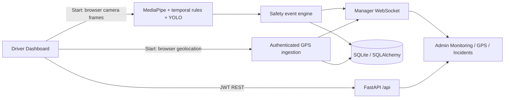

# FleetGuard project status report

**Audit date:** 25 November 2026
**Scope:** Current checked-out frontend and backend source, local backend configuration, registered FastAPI routes, and the latest automated validation. This is a source review; it does not certify a production deployment or real-device behavior beyond the user-reported results below.

## Executive summary

FleetGuard has two role-separated portals in one React application: a fleet manager/admin portal and a driver portal. Both use a FastAPI backend, a local SQLAlchemy database, role-scoped REST endpoints, and a manager-only WebSocket. The project has substantial working end-to-end paths: authentication, admin and driver views, browser-camera AI, safety event persistence, incident/alert escalation, evidence capture and review, and simulated/live GPS handling.

This is a functional single-machine prototype, not a production-ready multi-fleet service. The major unfinished areas are: resolving the reported runtime 404 during live GPS submission; verifying successful GPS persistence and Admin map receipt on the real browser; phone detection (the user previously reported it failed in a laptop-camera test); reliable multi-driver/multi-instance inference; operational CRUD and trip-management screens; real historical analytics and dynamic safety scores; and cloud deployment/storage.

### Current validation

- Backend `unittest` suite: **125 passed, 1 skipped**. The skipped test is explicitly camera-hardware opt-in.
- Frontend `npm run build` (`tsc -b && vite build`): **passed**.
- FastAPI OpenAPI generation includes `POST /api/gps/my-location`.
- User-reported camera validation: camera access, presence, eye closure/drowsiness, yawn, head-left and head-right distraction passed; phone detection failed.
- User-reported GPS validation: browser returned coordinates `13.326002, 77.126609` at ±101 m for driver DRV-001 / vehicle VEH-001; the UI displayed a 404 and did not show an accepted/sent timestamp. Therefore real GPS ingestion and Admin receipt remain unverified.

## Application shape and access

### Portals

- **Fleet manager/admin:** `/` plus `/drivers`, `/vehicles`, `/monitoring`, `/gps-tracking`, `/incidents`, `/analytics`, and `/settings`.
- **Driver:** `/driver` and `/settings`.
- Login offers manager and driver sign-in modes. The backend authenticates with bearer JWTs. A role guard blocks drivers from manager pages and managers from the driver-only page; root and catch-all routes redirect by role.
- Demo mode exists for a manager without the backend. Driver demo login is intentionally not supported; driver login and the driver dashboard require backend authentication.
- Current front-end default is real-backend mode (`VITE_USE_MOCK` must be explicitly `true` to enable frontend mocks). The checked local backend `.env` uses SQLite, `AI_MODE=live`, and `GPS_MODE=simulation`.

### Main data paths

The diagram describes the intended/current source flow. The real GPS upload is specifically still unverified after the user saw a 404. Driver browser camera status reaches the driver immediately through the frame-response API; the Admin UI gets event/status broadcasts and polls the active browser-session list. The Admin UI is not a remote raw-video viewer for every driver.

## Fleet manager/admin portal

### Overview dashboard — integrated, with data limitations

- Loads driver, vehicle, incident, alert, GPS location and safety-trend APIs.
- Fleet cards are calculated from returned driver, vehicle and incident rows.
- Safety trend, live alerts feed and fleet map are displayed.
- WebSocket `incident_created` and `alert_created` trigger refreshes. The dashboard overview map does not patch positions for each GPS WebSocket message; the dedicated GPS Tracking page does.
- **Data caveat:** the backend analytics endpoint repeats the fleet’s current average safety score across historical buckets. Only incident counts are counted by date. The map subtitle in the overview calls positions “Simulated” even when a live location may be present. Treat the graph/label as needing correction before operational use.

### Drivers — integrated read views; management actions missing

- Search/filter driver list, profile detail, assigned vehicle, incident history and event timeline are wired to backend reads.
- Backend supports role-scoped listing and detail retrieval.
- No manager UI/API flow currently adds a driver, edits profile/license/status, suspends/reactivates them, or manages accounts from this page.

### Vehicles — integrated read views; fleet operations missing

- Search/filter vehicle list, detail, assigned driver, incidents, and current location.
- Backend list/detail endpoints are manager-only; drivers can read only their assigned vehicle.
- No vehicle create/edit/retire workflow, assignment screen, maintenance workflow, or service-record management UI is present. Backend data models include maintenance records, but the current routes/UI do not expose a full maintenance workflow.

### Live Monitoring — integrated status/events; remote camera viewing is limited

- Admin reads monitoring statuses, event history, AI health/configuration and active browser camera sessions.
- Manager WebSocket handles monitoring status and safety events; the browser camera-session list is refreshed by REST polling every five seconds.
- The driver’s camera session sends status and events to this page. The current admin UI reports session health and signals, rather than rendering that driver’s raw camera feed.
- There is a separate manager-side camera card that can open the manager browser’s own webcam or a configured DroidCam/backend feed and submit frames through the shared monitoring endpoint. This is not the same thing as remotely opening each driver’s in-cab camera.
- In-cab warning audio and test/mute controls are implemented in browser UI; browser autoplay/device policies still apply.

### GPS Tracking — live/simulated/stale model exists; live end-to-end unresolved

- Admin gets a REST position snapshot and patches markers from `gps_update` WebSocket events. Markers and list distinguish live, simulated and stale positions, with timestamps and accuracy where available.
- Driver explicitly starts/stops browser geolocation. The backend binds submitted fixes to the authenticated driver’s assigned vehicle, validates coordinates, timestamp, accuracy and update frequency, persists a `GPSLocation`, and broadcasts it.
- Live positions take precedence over simulator positions. In simulation mode, a vehicle without a live fix may show a labeled generated point. In live-only mode, the API does not silently fall back to generated coordinates. A disconnected live location remains visible as stale.
- **Current known runtime issue:** user saw GPS acquisition but got `404 Not Found`, with “Last sent: pending”; the assigned-vehicle card remained simulated. Current source/frontend URL and FastAPI registered path agree, so the failure has not been pinned to a source mismatch. The live runtime URL/process still needs to be verified, then a real accepted POST and Admin WebSocket update must be confirmed.
- **UI state caveat:** the DriverLocationControl marks itself “LIVE GPS” on receiving a browser geolocation callback, before the backend accepts the POST. A failed upload can therefore coexist with that label. The server-accepted “Last sent” indicator is the stronger success signal.
- Browser location is device/browser geolocation, not dedicated vehicle-grade GPS. User-observed accuracy was ±101 m. The checked local `.env` currently selects `GPS_MODE=simulation`.

### Incidents, alerts and evidence — mostly integrated

- Admin incident table supports paging, searching, severity/status filtering and evidence filtering. Incident detail supports status review/resolution, deletion, evidence playback/snapshot, download, hash verification and retention protection.
- AI events are persisted. High-severity qualifying events may escalate to incident + alert, with a cooldown to limit duplicate incidents. Admin receives real-time create/delete/evidence notifications.
- Driver sees their own incident list; driver endpoint is scoped to the authenticated account.
- Alert read path is implemented and used on the overview. There is no dedicated alert inbox, acknowledge/resolve workflow, delivery integration (SMS/email/push), or alert preference management.
- Evidence files are stored locally, transcoded from WebM to MP4, checksummed, quota-managed and subject to retention cleanup. A cloud storage provider class is a stub, not a real S3/GCS/Azure upload. Evidence requires FFmpeg; capture can fail if the source stream is unavailable/placeholder or the quota is exhausted.
- Some event classes are records only: incident escalation currently requires `severity == high` and event type in drowsiness, eye closure, phone use, or distraction. Yawning and no-presence do not create incidents through that rule. GPS coordinates are not attached to incident locations; the safety engine stores a vehicle/plate label with an explicit “live GPS not attached” note.

### Analytics — connected, but historical accuracy is incomplete

- Incident breakdown and leaderboard query the database.
- Fleet utilization repeats the current active/idle/maintenance counts across dates; it is not a historical utilization series.
- Safety score values are seeded/stored driver fields. The source does not show a score recomputation when safety events arrive, so displayed scores are not a live rolling score.
- Trend chart labels/presentation may look historical even though the backend has limited snapshot-like history. Build a real event/trip/GPS aggregation model before using it for decisions.

### Settings — diagnostics and local preferences, not an admin configuration console

- Theme, local browser audio mute/volume, test tone, backend/WebSocket/AI status and account sign-out are wired.
- Organization name is disabled/read-only. AI/GPS configuration is changed in backend environment variables and requires restart; it is not an authenticated UI operation.
- Threshold values shown in the Settings page are hard-coded and do not match the checked backend configuration (for example, UI EAR `< 0.125` versus backend `.env` `AI_EAR_THRESHOLD=0.19`; UI drowsiness `1.0 sec` versus backend `.env` `0.8`). This should be fixed by rendering values returned from the backend or by correcting the labels.

## Driver portal

### Dashboard and personal data — integrated

- Reads the authenticated driver profile, assigned vehicle, own trips, own incidents, assigned-vehicle GPS and monitoring status.
- Shows current trip summary, stored safety score, incident count, completed-trip/distance totals, profile and vehicle, trip history and recent safety events.
- Dashboard refreshes these REST reads every ten seconds. This is polling, not a live driver WebSocket subscription.
- The data is scoped by server identity where implemented; the frontend does not send a vehicle ID with a GPS update, so clients cannot choose another vehicle.
- No driver actions to start/finish a trip, report vehicle defects, request assistance, manage an assignment, or update account/license information are present.

### Browser camera AI — implemented; user validated core signals, phone remains a gap

- Driver explicitly starts camera monitoring; browser requests camera permission and previews the live stream locally.
- Frames are resized/compressed and uploaded to authenticated `/monitoring/my-camera-frame`; continuous raw video is not uploaded/stored by this frame loop. The server uses MediaPipe face landmarks, EAR eye closure/drowsiness rules, MAR yawn rules, head-pose/yaw distraction rules, driver presence and temporal smoothing/hysteresis.
- Phone detection is wired to pretrained Ultralytics YOLOv8n COCO class 67 with a driver-zone heuristic and diagnostics. The user’s real-camera validation reported phone detection failed. Do not present that feature as field-validated or fixed.
- Frame status, accepted count, timings and phone diagnostics are shown in development mode. Driver receives immediate events/status in the frame-response path; Admin receives monitoring/event/incident/alert events over WebSocket.
- Browser recording captures a pre/post event clip in the client and uploads incident evidence through an authenticated driver-scoped route. Separately, backend evidence code can use its server camera’s rolling buffer. The evidence path should continue to be checked for the intended source, especially when the active inference is browser-supplied rather than the server camera.
- The backend browser-session registry is in process memory and intentionally permits **one active browser camera session per backend process**. Inference is serialized on shared detector/model instances. This is a prototype limit, not scalable multi-driver inference.
- Gaze-down/eye-direction tracking is explicitly not implemented in README. Phone performance remains model/camera-condition dependent; no custom training has occurred.

### Browser GPS — implemented client/backend pieces; no accepted real fix yet

- Geolocation is requested only after the driver presses Start; Stop clears the browser watch. Accuracy, speed, heading and timestamps are sent with the location.
- Backend has GPS policy/config, validation, persistence, stale state and WebSocket broadcast. The user has confirmed browser geolocation works for DRV-001/VEH-001, but also reported the upload 404.
- Thus: **real geolocation acquisition = confirmed by user; successful live GPS API persistence/Admin delivery = not confirmed.**

## Backend and data layer

- FastAPI REST routes are grouped under `/api`; WebSocket is `/api/ws`. Current route families: auth, drivers, vehicles, trips, fleet summary, incidents, evidence, alerts, GPS, monitoring, analytics and health.
- SQLAlchemy models include users, fleets, drivers, vehicles, trips, GPS locations, safety events, incidents, alerts, evidence and maintenance records. Local configured database is SQLite (`backend/fleet.db`); migrations are non-destructive schema additions.
- Authentication supports manager/admin and driver roles. Driver profile, assigned vehicle, own trips, own incidents, GPS upload and camera-session/frame routes are driver-scoped. Admin-only routes protect fleet-wide reads/operations.
- WebSocket validates a manager/admin JWT and broadcasts to connected managers. Driver camera gets immediate response from its REST frame upload; driver does not consume the manager fleet socket.
- Background API lifespan initializes/migrates the database and starts a task that generates configured simulation updates and optional server-camera AI work.
- Local filesystem is the active evidence provider. Cloud provider is a stub. The in-memory camera-session registry and shared worker are single-process; multi-worker horizontal scale requires shared session/lock state, queueing, model capacity controls and cross-worker event fanout.

## What is integrated versus not

### Integrated in current source

- Separate manager and driver portals with route-level role guards.
- JWT authentication and backend-bound driver identity.
- Persistent SQL database models and seeding/migrations.
- Driver browser-camera frame inference to the backend and temporal safety detections.
- Safety event persistence, incident/alert escalation, manager WebSocket broadcast.
- Browser incident recording/evidence upload, local MP4 conversion, local retention/quota/hash workflow.
- Browser geolocation capture controls, backend GPS endpoint, GPS persistence/source labeling and Admin WebSocket/map update path.
- Clearly labeled GPS simulator and mock/demo frontend mode.
- Admin read dashboards for fleet, drivers, vehicles, monitoring, GPS, incidents and analytics.
- Automated backend tests and TypeScript/Vite production build.

### Partial, misleading, or not yet validated

- Live GPS: source route exists but user’s browser request got 404; no successful real fix or Admin receipt verified.
- Phone detection: detector/integration exists, but user’s real camera test failed. Further investigation and controlled placement test required.
- Admin visibility into driver cameras: session health/status is visible, but raw individual driver video is not streamed to the Admin page.
- Analytics: some reports use live database values, but trend history/utilization are approximations; safety score is not recomputed from events.
- Settings thresholds: display values are hard-coded and conflict with current backend configuration.
- Incidents/evidence: most paths work; availability depends on source stream, FFmpeg, local disk and quota. Cloud archive not implemented.
- Real deployment readiness: environment is local SQLite/dev setup, with single-process constraints and no demonstrated production deployment.

### Not built (or no current end-user workflow found)

- Manager driver/vehicle CRUD and assignment management screens.
- Driver/admin trip dispatch, start/finish and full trip operations in the UI (backend manager trip routes exist; driver trip screen is read-only).
- Maintenance management despite a maintenance data model/status.
- Dynamic safety-score computation and a true historical analytics warehouse.
- Admin remote raw-video viewing for multiple driver streams.
- Multiple simultaneous browser-camera AI sessions and horizontal scaling.
- Real cloud evidence object storage and retry/monitoring lifecycle.
- Gaze-down detection, custom-trained phone detector, vehicle hardware/OBD telematics, geofencing, route deviation, speed-limit enforcement, offline mobile queueing, push/SMS/email notifications, and organization/tenant management.
- Production deployment, secrets rotation/configuration management, operational observability/alerting, backup/restore and disaster recovery are not demonstrated in this checkout.

## Recommended build order

1. **Close live GPS validation:** restart the backend from this checkout; inspect the exact browser Request URL/method and backend access log; confirm authenticated POST accepts and persists; confirm matching `gps_update` and Admin marker update; fix the underlying runtime URL/process if still failing. Then fix the UI so “LIVE GPS” is not shown as server-live until an update is accepted.
2. **Finish phone detection investigation:** capture development diagnostics from controlled no-phone/large-in-hand/near-face/lower-zone/remove trials; establish whether YOLO sees class 67, what confidence/bbox it gives, and where the event path drops. Preserve current face and temporal algorithms. Consider custom training only if those measurements prove pretrained YOLO is insufficient.
3. **Make operational data truthful:** load thresholds from backend; replace snapshot-shaped analytics with timestamped aggregates; define score formula, recomputation and history; attach GPS/event location where appropriate and distinguish unknown from simulated.
4. **Complete core fleet workflows:** driver/vehicle create/edit/assignment; trip dispatch/start/end; vehicle maintenance; alert acknowledgment and notification policy.
5. **Scale AI safely:** move active session state to shared storage; add queue/backpressure, per-camera/model capacity, worker health, retention policies and multi-instance WebSocket fanout; then enable multiple live driver cameras.
6. **Productionize:** cloud object storage with access policies and retries; production database; deployment pipeline; secrets/config handling; monitoring/logging; backups/restore; browser/device matrix and privacy/data-retention controls.

## Files to orient yourself

- Frontend routing and role guards: `src/routes/AppRoutes.tsx`, `src/routes/RequireRole.tsx`, `src/components/layout/Sidebar.tsx`.
- Admin dashboard: `src/pages/DashboardPage.tsx` and `src/pages/MonitoringPage.tsx`.
- Driver dashboard: `src/pages/DriverDashboardPage.tsx`, `src/components/drivers/DriverCameraPanel.tsx`, `src/components/drivers/DriverLocationControl.tsx`.
- GPS API and map: `src/services/api/gpsService.ts`, `backend/app/api/routes/gps.py`, `backend/app/gps/simulator.py`, `src/pages/GpsTrackingPage.tsx`.
- AI/session pipeline: `backend/app/ai/vision.py`, `backend/app/ai/live_monitor.py`, `backend/app/ai/phone_detector.py`, `backend/app/ai/browser_sessions.py`, `backend/app/api/routes/monitoring.py`.
- Event escalation/evidence: `backend/app/services/safety_engine.py`, `backend/app/services/incident_recorder.py`, `backend/app/api/routes/evidence.py`.
- Backend route mounting: `backend/app/api/routes/__init__.py`, `backend/app/main.py`.
- Full backend tests: `backend/tests/`; frontend scripts: `package.json`.

## Bottom-line status

The project already connects both dashboards to a real backend and contains working real-time camera-AI, safety-event, incident, evidence and GPS design paths, alongside labeled simulation. The driver camera core signals have user-reported real-camera validation; phone detection has a reported failure. Real browser location acquisition has user confirmation, but the reported 404 means live GPS ingestion/Admin receipt is not yet proven. The remaining priority is to close that live GPS runtime check, complete phone detection investigation, correct misleading/static operational metrics, and then build fleet workflows and multi-driver production infrastructure.
